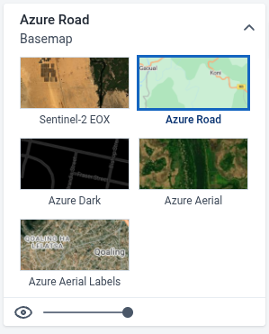

# Azure Maps and Bing Maps basemaps setup { #azure-maps-and-bing-maps-basemaps-setup }

Azure Maps and Bing Maps can be used as basemaps in the DHIS2 Maps app and the DHIS2 Android Capture app. In the Maps app, each provider adds four basemaps: Road, Dark, Aerial and Aerial Labels.

{.center}

Microsoft is retiring Bing Maps. Free (Basic) Bing Maps keys stopped working on 30 June 2025, and paid Bing Maps for Enterprise licences end on 30 June 2028. Use Azure Maps unless your organisation already has a paid Bing Maps licence. See [Migrate from Bing Maps to Azure Maps](https://learn.microsoft.com/azure/azure-maps/migrate-bing-maps-overview).

To enable the Azure Maps basemaps:

1. Create an Azure subscription and an Azure Maps account. See [Manage your Azure Maps account](https://learn.microsoft.com/azure/azure-maps/how-to-manage-account-keys).
2. Copy the account's primary key, which Azure Maps uses as the subscription key. See [View authentication details](https://learn.microsoft.com/azure/azure-maps/how-to-manage-authentication#view-authentication-details). Azure Maps is pay-as-you-go, with a free monthly allowance of transactions: see [Azure Maps pricing](https://azure.microsoft.com/pricing/details/azure-maps).
3. In the System Settings app, open **Server settings** and enter the key in **Azure Maps API key**.

If your organisation has a paid Bing Maps for Enterprise licence, enter its key in **Bing Maps API key** instead.
