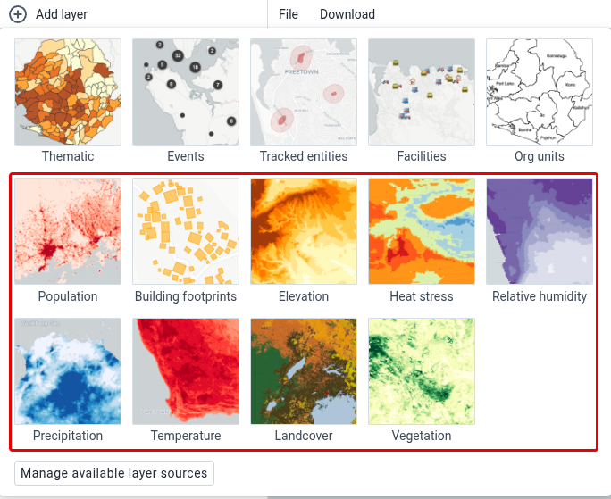

# Google Earth Engine sign-up { #accessing-map-layers-from-google-earth-engine }

DHIS2 has a powerful integration with [Google Earth Engine](https://earthengine.google.com/) allowing you to access detailed datasets for population (WorldPop), building footprints, elevation, land use and climate. The Maps app shows them as map layers, the Climate app uses them for climate and environmental data, and the Import/Export app can import them as data values.

{.center}

DHIS2 connects to Earth Engine through a Google service account that your organisation owns. This guide shows how to set it up: you create a Google Cloud project registered for Earth Engine, and a service account in it with two roles, **Service Usage Consumer** and **Earth Engine Resource Admin**. You then install the service account's JSON key file on your DHIS2 server or servers, and all users of those DHIS2 instances can access the Earth Engine layers. The whole setup takes about 20–30 minutes.

> **Note**
>
> This guide is not an official Google resource and is not endorsed by Google. Google changes its products, screens and policies, sometimes on short notice, so some steps may be out of date or incorrect. Always check the linked Google guides for the current process. To suggest a correction, please open a ticket on [DHIS2 Jira](https://dhis2.atlassian.net).

## Before you start

The person setting up the project needs a Google account in your organisation with the permissions below. If you do not have any of these permissions, ask your Google Cloud administrator.

| What you need | Why |
|---|---|
| Project Creator (`roles/resourcemanager.projectCreator`) | To create the new project |
| Billing Account User (`roles/billing.user`), if billing is required | To link a billing account (needed for commercial use or the noncommercial Contributor Tier) |
| Owner on the new project, or Service Account Admin + Project IAM Admin + Service Account Key Admin | To create the service account, grant roles and create a key |

Also decide whether your Earth Engine use is **noncommercial** (research, education, nonprofit) or **commercial**. This distinction will help determine the appropriate registration process in Step 2.

## If your organisation doesn't have a Google account

You need a Google account to use Google Cloud, but not Gmail or Google Workspace. Choose one of these options:

| Option | How | Best for |
|---|---|---|
| **Cloud Identity Free** (recommended) | [Sign up for Google's free Cloud Identity service](https://support.google.com/cloudidentity/answer/7389973) and verify your organisation's domain (e.g. @health.gov.xx); this needs someone who can add a DNS record. Takes about 30–60 minutes. | Organisations: the project belongs to the organisation, not to one person |
| **Google account with your work email** | On the [Google account sign-up page](https://support.google.com/accounts/answer/27441), choose **Use your existing email** and enter your existing work email. No Gmail needed. | Quickest option; the project sits under "No organisation" |
| **Personal Gmail account** | Sign up for a standard Gmail account. | Last resort only |

If you use a work email or personal Gmail account, the project is tied to one person's account. If that person leaves, your organisation can lose access. To avoid this:

- Create the account with a shared, organisation-controlled mailbox (e.g. gis@your-org.xx), **or**
- Add at least one more colleague as **Owner** of the project (**IAM & Admin → IAM → Grant access**).

If you choose Cloud Identity, the person who signs up becomes its first **super admin**. Because this account is on your own domain, your organisation can always [recover it](https://support.google.com/a/answer/33561): whoever manages your domain's DNS can prove ownership again if all admins are locked out. To make the setup more resilient:

- Use a role-based admin account (e.g. gcp-admin@your-org.xx), with its password stored where the organisation controls it.
- Have at least two super admins.
- Keep track of who manages your domain's DNS.

A Cloud Identity organisation created now blocks service account key creation by default: see Step 4.

The rest of these instructions are the same whichever option you choose.

## Step 1: Create the Google Cloud project

1. Go to [console.cloud.google.com](https://console.cloud.google.com) and sign in with your organisation's Google account.
2. Click the project selector at the top of the page, then **New Project**.
3. Enter a **Project name** (e.g. My Org Earth Engine). Note the **Project ID** shown below it; you can edit it now but not later.
4. Select your **Organization** and **Location** (folder), then click **Create**.
5. If you need billing: open **Billing** in the left menu and link a billing account to the project.
6. Make sure the new project is selected in the project selector before continuing.

Google guide: [Creating and managing projects](https://docs.cloud.google.com/resource-manager/docs/creating-managing-projects)

## Step 2: Enable Earth Engine and register the project

1. Go to the **API Library**. You can find it under **APIs & Services → Library** in the navigation menu, or through **Quick access** if it is shown there. Search for **Google Earth Engine API** and click **Enable**.
2. Open the Earth Engine registration page at [code.earthengine.google.com/register](https://code.earthengine.google.com/register) and select the project from Step 1.
3. Choose **noncommercial** or **commercial** use.
4. For noncommercial use, answer the eligibility questions and choose a tier:
    - **Community Tier** (default): 150 compute hours per month, no billing account needed.
    - **Contributor Tier**: 1,000 compute hours per month. Requires a billing account, but Earth Engine noncommercial use is not charged.
5. For commercial use, link a billing account and choose a pricing plan.

Access is enabled as soon as registration is complete. Noncommercial projects must reverify their status once a year.

Also check that the **Service Usage API** is enabled (**APIs & Services → Library**); it usually is by default.

Google guides: [Earth Engine access](https://developers.google.com/earth-engine/guides/access) · [Noncommercial tiers](https://developers.google.com/earth-engine/guides/noncommercial_tiers)

## Step 3: Create the service account and grant the roles

1. In the navigation menu, go to **IAM & Admin → Service Accounts** and click **Create service account**.
2. Enter a **Service account name** (e.g. ee-service) and a short description. Click **Create and continue**.
3. Under **Grant this service account access to project**, add both roles:

    | Role | Role ID |
    |---|---|
    | Service Usage Consumer | `roles/serviceusage.serviceUsageConsumer` |
    | Earth Engine Resource Admin | `roles/earthengine.admin` |

4. Click **Continue**, skip the optional user access step, and click **Done**.

Google guides: [Create service accounts](https://docs.cloud.google.com/iam/docs/service-accounts-create) · [Earth Engine roles and permissions](https://developers.google.com/earth-engine/guides/access_control)

## Step 4: Create the key and install it in DHIS2

1. In the navigation menu, go to **IAM & Admin → Service Accounts**, and click the service account you created.
2. Open the **Keys** tab, then **Add key → Create new key**.
3. Choose **JSON** and click **Create**. The key file downloads to your computer.

If the console shows **Service account key creation is disabled**, your Google Cloud organisation blocks key creation. This is the default for organisations created on or after 3 May 2024. Someone with the **Organization Policy Administrator** role (`roles/orgpolicy.policyAdmin`) on the organisation must allow key creation for this service account. Then create the key again. See Google's guides [Troubleshoot organization policy errors](https://docs.cloud.google.com/iam/docs/troubleshoot-org-policies) and [Secure by default organizations](https://docs.cloud.google.com/resource-manager/docs/secure-by-default-organizations).

**Store the key file securely.** It grants access to your Earth Engine project, so treat it like a password: don't email it, post it in chat, or commit it to a code repository.

Then install it in DHIS2:

1. Rename the file to `dhis-google-auth.json`.
2. Place it in your DHIS2 folder, alongside the `dhis.conf` file.
3. Restart the DHIS2 server.

To check that DHIS2 loaded the key, see [Check that DHIS2 loaded the key](https://docs.dhis2.org/en/manage/reference/google-service-account-configuration.html#check_google_service_account_configuration).

Guides: [Create and delete service account keys](https://docs.cloud.google.com/iam/docs/keys-create-delete) (Google) · [Google service account configuration](https://docs.dhis2.org/en/manage/reference/google-service-account-configuration.html) (DHIS2)

## Final checklist

- [ ] Project created (and billing linked, if needed)
- [ ] Google Earth Engine API enabled
- [ ] Project registered for Earth Engine
- [ ] Service account created with Service Usage Consumer and Earth Engine Resource Admin
- [ ] JSON key created and stored securely
- [ ] Key renamed to `dhis-google-auth.json`, placed next to `dhis.conf`, and DHIS2 restarted
